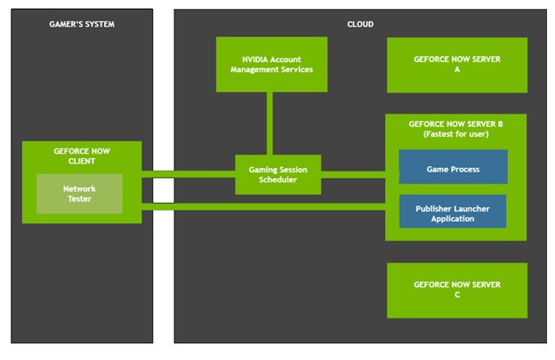
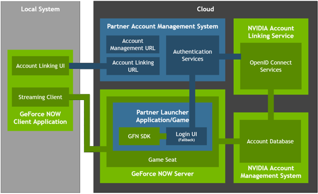
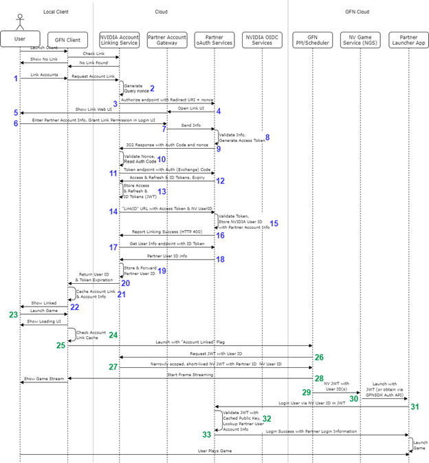
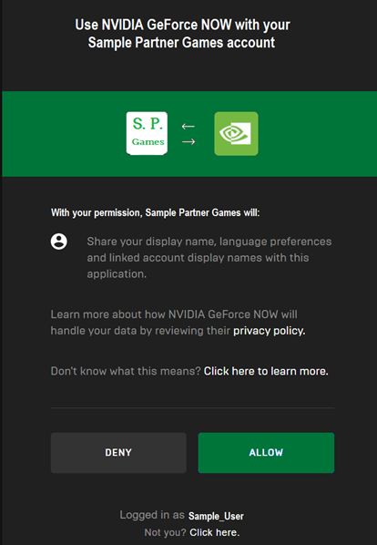

# GeForce NOW Software Development Kit: Account Linking, Single Sign-On and Game Ownership Syncing

Document History

| Version | Date | Description of Change |
| :----: | :----: | :---- |
| 1.0 | 05/24/2021 | First release version |
| 1.1 | 03/21/2022 | Updated the unlinking API |
| 1.2 | 01/14/2025 | Updated Account Linking, SSO and added game ownership sync |
| 1.3 | 03/26/2025 | Minor updates |
| 3.0 | 05/26/2025 | Conversion from PDF to Markdown |

## Introduction
NVIDIA GeForce NOW (GFN) is a cloud-based service that allows gamers access to play their game library on a vast number of platforms, anywhere they have an internet connection. It also allows games with older and underpowered PCs to experience modern games with the latest technologies without the need to upgrade their PC hardware.

Most games and their respective platform launcher applications, such as Valve Steam, Epic Games Launcher or Ubisoft Connect, or even the games themselves, require the gamer to login into a unique platform and/or game account to play the games. By default, this login step creates a pain point in the user’s gaming session, keeping the user from achieving a seamless “launch and play” experience in GFN. 

To alleviate this pain point, certain integration actions can be taken by both GFN and partner account systems to allow automatic login of the user during these game sessions. 

## Audience
This document is directed towards platform launcher applications and game developers that wish to have tighter integration with the GFN platform, and give their users better experiences using their applications and games in GFN.

## Overview
This document provides an overview of Account Linking (AL), Single Sign-On (SSO) and Platform Game Ownership Syncing (PGOS) principles, as well as practical integration of these concepts with the GFN ecosystem.

## Overview of GFN Ecosystem
GFN focuses on high-performance, low latency gaming to provide gamers with a great user experience. This is accomplished by having powerful servers loaded with the latest GeForce GPUs spread all over the globe, and with advanced scheduler and routing software to get the user to a server that will provide them the best experience.



GFN is a Bring-Your-Own-Game platform, meaning that users will play supported titles from the platforms they purchased or entitled to play their games from. Many of those platforms have proprietary account systems that the users must provide credentials for to access their games, which requires users to enter their credentials during a game streaming session. This is a poor user experience, which can be really poor in certain scenarios, such as the user playing on a mobile phone, and must enter a complicated username and/or password via an on-screen keyboard or controller.

## Overview of Account Linking and Single Sign-On
Almost all online services have some type of user account system, requiring users to enter their credentials. Many of these services have some level of integration with each other to provide the user a better experience. In those cases, the best integrations allow the user to share account information from one service to another so that the user does not have to enter their user account credentials of all the integrated services across various supported platforms. This is known as Single Sign-On (SSO).

GFN supports SSO with the developers of the games and applications that can be played on GFN. By enabling SSO of a gamer account information with GFN, the user can skip the need to manually log into the platform launcher or game they are currently playing in GFN, thus getting them into the game faster with a more seamless experience.

Supporting SSO requires NVIDIA and partner account/Identity Management (IDM) systems to talk directly with each other and exchange account information. Brokering account information on the behalf of the user requires the users to initiate the syncing of accounts data, which is known as Account Linking.

In short, a user must link their GFN account to their partner account to authorize the sharing of information that provides SSO support for the partner’s game catalog supported by GFN.

## Overview of Platform Game Ownership Syncing
On top of Account Linking and Single Sign-On features, GFN also supports platforms to share their member’s game ownership details. We call this Platform Game Ownership Sync (PGOS) support. This feature will require the account linking phase to be completed by platform users by granting the necessary permissions to GFN. After these permissions are granted directly by the platform user, GFN can use APIs that are provided by the platform to access the user’s game ownership information. 

## Linking Accounts
NVIDIA leverages OpenID Connect (OIDC) interaction and constructs for account linking with partner IDMs. This is to prevent the need to develop custom code for each partner supported by GFN. In addition to utilizing standard OIDC, this account linking model used by GFN is considered to be a “Partner Owns Account Link” model, or “Partner Links GFN” model. In this model:

* The partner IDM acts as the Identity Provider (IdP), not NVIDIA.  
* The partner IDM provides the web UI for the user to enter their partner account credentials to authorize GFN to have access to their account data.


* The partner user ID is provided to NVIDIA account linking services to be stored as part of the GFN user account information.  
* The partner user ID is used as the key data between the backends to enable SSO in the game seat.  
* Optionally, the partner can use the GFN user ID as a secondary mapping reference.  
* Any web-based partner account management system cannot initiate the account link due to the exchange of information with NVIDIA web services.

A block diagram of the various modules and services and their interactions is as follows:



On the local system, the GeForce NOW client must be able to control the account linking flow itself, both linking and unlinking, as well as provide proper authentication information to the cloud services. Any local partner client **cannot** initiate the account link due to the need to redirect back to NVIDIA services. See later sections for the specifics behind this.

Outside of the local client system, the NVIDIA and partner web services must interact and share authentication data directly with each other. This sensitive data cannot go through local system applications for security purposes. These systems include the partner/publisher IDM that interacts directly with the NVIDIA Account Linking System (ALS). The NVIDIA ALS will broker all interactions on behalf of NVIDIA IDM services via OIDC standards.   
The top-down interaction and flow is as follows:



The diagram is defined as having all account linking actions in blue (**Steps 1 through 22**), and a sample SSO-enabled game stream launch in green (**Steps 23 through 33**). The diagram focuses on account linking via the GFN client as it is the only point that the flow can be initiated from.

Exploring this diagram top down, the GFN user will request the GFN client to begin the account linking process (**Step 1**). The GFN client will ask the NVIDIA ALS to initiate and broker the account linking process with the partner backend services. The NVIDIA ALS will generate a nonce to identify the request flow (**Step 2**), then call a partner-defined URL in a web browser that will trigger the account linking flow (**Step 3**). This allows the partner backend to present web UI (**Step 4-5**) to the user that allows them to:

* Enter their partner account credentials.  
* Be informed what it means to link accounts.  
* What they are agreeing to share.  
* Manually authorize the account link to GFN.  
* Be allowed to switch partner accounts in the event they have multiple accounts.

 

Once the user authorizes the account link in the authorization UI (**Step 6**), NVIDIA must receive a 302 response from the partner backend that redirects the nonce and an authorization code back to the NVIDIA ALS (**Step 9**). The nonce will allow ALS to validate the request origination and authenticity, and store the authorization token for the next set of actions with the partner backend services (**Step 10**). It is this nonce, and the origination with ALS, that prevents any other application or web service from initiating this linking flow.

With the authorization token, ALS will exchange the authorization token for access and refresh tokens for future queries (**Step 11-13**). Optionally, if the partner has provided an endpoint to obtain the GFN user ID, ALS will make this endpoint call (**Step 14**) to allow the partner to store it as part of the user’s partner account info (**Step 15**).

It is also at this point that ALS will request the partner user ID from the partner backend (**Step 17-19**), so that it can be cached displayed in the GFN client UI for the informational purposes to the user (**Step 21-22**), and can be used as part of all SSO requests during streaming sessions.

## Performing SSO at Game/Application Launch in GFN
On launch of the partner game or application in GFN (**Step 23**), the GFN client initiates the streaming session with data that denotes the account link state it has cached (**Step 24-25**). This is done for launch performance reasons so that cycles are not spent on every stream launch querying web services for linked account data; limiting the calls to only known linked states.

Once the request comes into the GFN streaming scheduler, it will ask ALS to provide linked account information (**Step 26**), which will be returned to the scheduler as a JWT (**Step 27**) that contains two critical pieces of information:

1. The partner user ID (as received during the account linking phase).  
2. The GFN user ID.

For more detailed information about the JWT, see Section 4 of this document.

The JWT is then made available to the partner application or game (**Step 30**). How the JWT is provided to the partner game or application is worked out between the two companies. NVIDIA suggests that the JWT be provided as part of Authentication Data APIs available as part of the GeForce NOW Software Development Kit (GFN SDK) available on GitHub to approved partners ([https://github.com/NVIDIAGameWorks/GeForceNOW-SDK](https://github.com/NVIDIAGameWorks/GeForceNOW-SDK)). However, this part of the integration is handled on a case-by-case basis.

The partner application is responsible for forwarding this JWT to partner backends for processing (**Step 31**). The backends are responsible for:

* Validate the JWT’s authenticity.  
* Parser the JWT for the user IDs.  
* Use partner user ID to look up the corresponding partner account that should be logged into the application.  
* Optionally, use the GFN user ID as a secondary check for the correct account info.  
  * Can only be done if the partner has provided a Link URL to ALS (**Step 14**).  
* Provide the necessary credentials/status back to the application to automatically log the user into the application (**Step 33**).

Failure to log the user into the game or application should not be a critical failure by default, as this would lead to a very poor experience for the user. Instead, the user should be asked to manually provide their account credentials to successfully play their game, and proper telemetry should be captured to denote the failure so it can be rectified in the future. While entering their credentials is not a great experience, it is a better experience than the user waiting, possibly several minutes in a queue, only to have the session exit with an error they could not control.

## Unlinking Accounts
Since the partner IDM owns the account link state, and the GFN client is designed to allow the user to link and unlink, the partner IDM must also provide an endpoint to NVIDIA for the GFN client to initiate the unlink when the user desires. Additionally, the partner may provide a mechanism in any account management web services provided to the user for the user to initiate the unlinking process as well. If this is provided, it is suggested that such entry is defined separately from any traditional account linking that allows third parties to act as the IdP so as to not confuse users that they can use their GFN credentials to log into partner services and applications.

If the user unlinks their accounts, the partner IDM must immediately revoke tokens so that GFN is aware the account link is no longer valid. If the user initiated the unlink through any partner provided interface or web service, the partner IDM must call the following GFN Unlink web endpoint defined by ALS to notify NVIDIA the user has unlinked their accounts. 

### Unlinking API
```c 
DELETE  /v1/linking/{platform}
Authorization: [SSA Token]

platform : platform identifier for which link will be deleted.
Response:
    200 OK
	401 Not Authorized (invalid ID token)
	403 Forbidden (token does not have required scopes)
	404 NotFound (Account Link does not exists) |
```

Request a JWT from SSA
```c 
POST /token
Authorization: Basic <Base64(client_id:client_secret)>
Content-Type: application/x-www-form-urlencoded grant_type=client_credentials&scope=<scopes>&options:B64ENC(platform_uid=<platform_uid>)
```

####  If the response code is not HTTP 200, the service/client should retry only below HTTP response status codes:

* 429 Too Many Requests  
* 500 Internal Server Error  
* 502 Bad Gateway  
* 503 Service Unavailable

Any retries should be implemented using an exponential back off strategy. All other HTTP response status codes should not be retried.

## Data Caching and Web Traffic Expectations
Per the flow diagram, the GFN client will cache the account link state received from ALS so as to not affect certain key execution metrics. However, it will still query ALS at well-defined intervals and user interaction states, including:

* GFN Client launches for each GFN user.  
* Start of gaming sessions for each GFN user.  
* Up to 24 hours since last request.

Depending on the length of time since ALS last received account information, ALS may forward the requests to the partner backend services, utilizing the stored partner access and refresh tokens. This means that the partner backend is expected to:

* Provide an endpoint to re-query the account link state and/or account information.  
* Re-issue tokens as part of the query.  
* Handle potentially thousands of requests per day.

## Supported Environments
GFN utilizes a public production (prod) and an internal staging (stg) environment. All initial integration work will first be performed against the staging endpoints to allow the process to be vetted before public users can make use of the feature. For security purposes, these environments will also leverage separate client secrets. Therefore, it is expected that the partner 

To correctly support these environments, the partner environment is expected to:

1. Support both environments, either by  
   1. Support a 1:1 mapping (prod\<-\>prod, stg\<-\>stg).  
   2. Have a production environment that supports both GFN environments, but make sure to hide the integration from the public while connected to the GFN staging environment.  
2. Support both sets of client secrets.  
   1. Utilize the correct secrets for the correct environment.  
   2. Keep the secrets secure separately.

The URLs for these GFN environments will be provided during the data exchange steps of the overall integration.

## Parsing the NVIDIA User ID JWT
As mentioned in the previous section of this document, the user account information is provided to the partner systems via JWT. The JWT schema is as follows:  
Header:
```c
{  
  "kid": "ERCO:IBXV:N66H:NPH2:3LFT:HCUU:2FAS:BINL:ZLJD:MZOY:DU7J:MYUY",  
  "alg": "RS256"  
}  
```       
Payload:  
```c
{  
  "sub": "kmk2av1csjuu7rj4uhhn8r2rhm",      
  "aud": "partner",  
  "access": [    
    {  
      "type": "account-link",  
      "name": "app",  
      "actions": [  
        "launch"  
      ],  
      "metadata": null  
    }  
  ],  
  "iss": "authn.nvidia.com",  
  "options": [  
   	"gfn_uid": "1234567890",  
	“platform_uid: “abcdef”  
  ],  
  "exp": 1620838675,   
  "iat": 1620838075,  
  "jti": "6822edad-b4fe-4a09-83d1-532af15f333c"  
}
```

The data of the JWT is as follows:

| Name | Purpose |
| :---- | :---- |
| kid | Key Identifier used to sign the JWT |
| alg | Algorithm of the key, (RSA Signature with SHA-256) |
| sub | Subject that generated the key |
| aud | Intended audience of the JWT, which would be the partner’s name |
| access | Token scope block |
| type | Type of token, which would be for account linking |
| iss | Token issuer, will always be an NVIDIA service |
| **gfn\_uid** | **NVIDIA account user ID** |
| **platform\_uid** | **Partner account user ID, as provided by partner user info endpoint** |
| exp | When the token expires, in seconds since Epoch |
| iat | Issued at, in seconds since Epoch |
| jti | JWI unique claim ID |

Many of the data elements of the JWT described are standard data elements, Refer to [RFC 7519](https://datatracker.ietf.org/doc/html/rfc7519) for further information about them.

Before reading data from the JWT, it should first be validated against the public key of the signing pair. This public key is always available at [https://authn.nvidia.com/pubJWKS](https://authn.nvidia.com/pubJWKS)). Verify that the kid values for both the public key and JWT are the same. Once the JWT is validated, then the uid data can be parsed for account look up purposes.

For manual validation, [www.jwt.io](http://www.jwt.io) can be very useful in this regard.

For performance reasons, the public key can be cached by partner backend services that validate the JWT. This can be done at service start, and re-checked every 24 hours. It is possible to query the public key at time of receiving and validating the JWT, however, this key query and roundtrip can take seconds, hurting overall launch performance of the game or launcher application running in GFN.

## Conclusion and Next Steps
Gamers find GFN valuable, and enjoy the ease of playing their games on many platforms, from many locations. Data has shown that gamers enjoy the service even more when they can get straight into the games they want to play. The tight integration of account services provides a seamless experience for gamers that gets them into their games quickly, and can be enabled without heavy processes and high overhead.

To make this flow happen end-to-end, it is the partner’s responsibility to provide NVIDIA documentation, either public or private, for the web endpoints to be called to:

* Invoke the account linking flow.  
* Initiate the account unlink.  
* Obtain the display name of the partner account for the user (for display purposes only).  
* Optionally, providing the GFN user ID to the partner IDM.  
* Pass the JWT to the correct in-stream partner application.

In addition to documenting these endpoints, the documentation must cover all data parameters, as well as success and error codes. NVIDIA will not start any account linking integration work until complete documentation is provided.

Conversely, NVIDIA will provide complete documentation on demand for the ALS endpoints APIs that will be used by the partner backend systems. For security reasons, they are not fully documented here.

To get started with this integration with GFN, or if there are additional questions not covered in this document contact your NVIDIA Developer Relations representative. This will begin a process of developer-to-developer interactions, covering open questions, culminating in the exchange of endpoint documentation mentioned in Section 3\. After these discussions, both companies can get to work and bring this better experience to the shared user base.

For information on acquiring and using the GeForce NOW SDK, please visit [https://developer.nvidia.com/geforce-now-sdk](https://developer.nvidia.com/geforce-now-sdk).  
