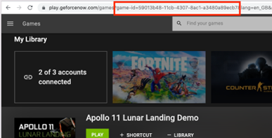
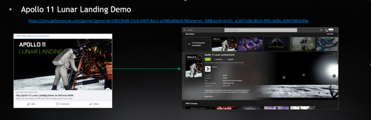

# GeForce NOW Software Development Kit: Deep Linking Integration Guide

| Version | Date | Description of Change | 
| :----: | :----: | :---- |
| 1.0 | 11/09/2023 | Initial release revision |
| 3.0 | 06/26/2025 | Updated to match functional improvements found in SDK 3.0 |

# Introduction
NVIDIA GeForce NOW (GFN) is a gaming service that uses the power of the cloud to take the GeForce PC gaming experience everywhere, to any device. GFN supports a feature called Deep Links, which are custom hyperlinks that lead a user to a specified game’s details and allows them to launch the game from a supported web browser. Deep Links allows GFN partners to create launch points on social media and web sites that lead a user to playing specific games on GFN, directly from a web browser.

## Audience
This document is directed towards various groups that are interested in leveraging GFN to provide their users access to playing games in a cloud environment:

* Publishers of games that wish to publish links to their games on GFN on their website or share links on social media.  
* Developers of game aggregator applications building live game catalogs that lead users into GFN game details page.

## Overview
This document provides a GFN Partner with:

* The format of Deep Links that GFN supports.  
* The flow of Deep Links into a supported GFN web browser.  
* Requirements and limitations of the Deep Links feature.

## Deep Links Format
The general format of GFN Deep Links is as follows:
```c
https://play.geforcenow.com/games?game-id=<game-id>&utm_source=<utm_source>&utm_campaign=<utm_campaign>
```

Please refer to the table below for details about URL parameters and their value.

| URL Parameters | Description |
| :---- | :---- |
| game-id | Required. ID of the target game. Example: game-id=59013b48-11cb-4307-8ac1-a3480a89ecb7 | 
| utm\_source | Required. Identifies the source of traffic. This could be a website name, company name or social network. Example:  utm\_source=gamesco |
| utm\_campaign  | Required. Identifies a specific promotion or strategic campaign tied to the link. This could be a product name, type of sale, contest name, etc. Example: utm\_campaign=summer-sale |
| utm\_medium | Optional. Identifies the medium used to share and access the link. This could be email, social, or another method. Example: utm\_medium=email |
| utm\_term | Optional. Identifies any search terms that were used by the user that resulted in this link being clicked. This is uncommon in the case of sharing links in campaign emails and on social media. Example: utm\_term=freegames |
| utm\_content | Optional. Identifies what kind of element was clicked (in the “medium”) to bring the user to the site, such as a click on a banner or a text link. Example: utm\_content=textlink |

## Obtaining the ID of a Game
The ID can be obtained in one of two ways, depending on the game's status in GFN:

* If game is available to play on GFN:
Open the game details page and get the value of URL parameter ‘game-id‘ from the URL shown in the browser address bar.



* If game is not Live yet on GFN.
Please contact your NVIDIA Account representative for access to the game-id, or obtain it from your game list in your organization inside developer.geforcenow.com.

## Deep Links to a Game Details Page
Deep Links launches the user’s default web browser and navigates the GFN web app to show details for the specified game.

From there, the user can attempt to play that game, and are guided through the normal steps needed to play on GFN:

* Registering or logging in with an NVIDIA account  
* Establishing a GFN membership  
* Ownership of the game along with the game’s platform account, if needed

  
           
Example Deep Link:

[https://play.geforcenow.com/games?game-id=59013b48-11cb-4307-8ac1-a3480a89ecb7\&utm\_source=nvidia\&utm\_campaign=test-campaign](https://play.geforcenow.com/games?game-id=59013b48-11cb-4307-8ac1-a3480a89ecb7#utm_source=nvidia&utm_campaign=test-campaign)

## Requirements and Limitations
Since Deep Links are a browser-based construct that leverages the GFN web-based app, GFN Deep Links are supported on Chrome browser 77.x (Windows or macOS) or later, Microsoft Edge 91.xx (Windows only) and Yandex (Windows and macOS). See the “Browser” details under [GeForce NOW system requirements](https://www.nvidia.com/en-us/geforce-now/system-reqs/) for more information.

Access to streaming game content requires a GFN membership. If the user is not logged in, they will be requested to either log into an existing account or create a GFN account.

Deep Links for the games that are unavailable in the user’s region will lead to the homepage of [https://play.geforcenow.com](https://play.geforcenow.com).
