# GeForce NOW Software Development Kit: How to Create a Mobile Touch Game Streamed From the Cloud

Document History

| Version | Date | Description of Change |
| :----: | :----: | :---- |
| 1.0 | 10/06/2021 | Initial release revision |
| 1.1 | 03/07/2022 | Added touch support for common game engines |
| 1.2 | 05/17/2022 | Wording cleanup in various sections |
| 1.3 | 06/08/2022 | Added Best Practices section |
| 2.0 | 06/27/2022 | Reworked to simplify |
| 2.1 | 05/26/2023 | Added a note at the bottom of section 8 regarding version 1.12’s method for retrieving the safe zone |
| 2.2 | 04/26/2024 | Added discussion about processing safezone data properly |
| 3.0 | 06/30/2025 | Conversion from PDF to Markdown |

## Introduction
NVIDIA GeForce NOW (GFN) allows users to enjoy their library of PC games on many internet-enabled devices via the power of cloud gaming. This includes PCs, Macs, Smart TVs, and mobile devices such as smartphones and tablets. 

As most PC games are designed to obtain input from keyboard and mouse input or XInput-based controllers, running these games on touch-capable devices creates a challenge that would traditionally be solved by building a native version of the game for those devices. GeForce NOW makes such a rebuild of the game not necessary; GFN has the ability to extend support for the game to such devices with little to no work by the game’s developers. This allows PC games, even very large games, to be instantly launched and enjoyed by a very large install base of users that are signing up for GFN to play their high-quality PC games.

## Audience
This document is directed towards game developers that wish to onboard their games into GFN, and would like to have their games available to GFN users utilizing touch-based devices with a positive user experience. 

## Overview
This document provides an overview of the GFN cloud environment as well as Mobile Touch support implemented in GFN. There are dedicated sections on the various ways game developers can modify their games to leverage GFN’s touch support capability, allowing developers to efficiently focus on the sections that pertain to their needs.

## Overview of the GFN ecosystem
GeForce NOW is an ecosystem that facilitates cloud-based PC gaming on a wide range of devices. The PC games run on high-performance Windows-based Virtual Machines located in various data centers around the world, while variants of the GFN client that run on Windows, macOS, Android phones, Android TV, Chromebook, iOS, and NVIDIA SHIELD products host the gaming experience for the user. This allows almost any system, even underpowered or older ones, to play the latest and most hardware-demanding games. 

For more information on GFN, including getting access to GFN if you do not already have it, please visit [https://www.nvidia.com/en-us/geforce-now/](https://www.nvidia.com/en-us/geforce-now/). For a listing of the latest global data centers and zones check out the GeForce NOW status page [https://status.geforcenow.com/](https://status.geforcenow.com/) 

## Overview of Mobile Touch Support in GFN
GFN's mobile touch experience aims to provide a seamless native gaming experience on mobile and touch-based devices, letting users interact with the game using their fingers instead of a gamepad or traditional keyboard and mouse. The experience is tuned to wider screens with higher pixel densities found on mobile devices and enables using touch as the primary input method. To realize this experience, GFN detects specific information about the user’s client device and then provides information cues to a game running on a GFN service to create an optimal visual and input experience for that device. In addition, the GFN Software Development Kit (SDK) provides the ability to integrate deeper with GFN by integrating PC game UI with on-screen keyboard input as well as accessing various server and client information to allow the game to make educated decisions on execution.

GFN’s Mobile Touch support is currently available for GFN clients on Android and iOS devices and comprises the following features:

* Game using touch input  
  * GFN supports gaming using touch input on mobile devices for all games that support touch inputs on Windows operating systems. GFN relays touch input from the user to the GFN gaming servers, where they are injected to the operating system which then generates touch or gesture messages, as the game requires.    
* Full-screen/Wide-aspect gaming  
  * GFN streams the game video in wider aspect ratios typically used in mobile screens to provide full screen gaming experience by avoiding letterboxing and pillarboxing.   
* Intuitive text input   
  * Text input is essential to enter usernames, passwords and chat messages  in games. GFN provides APIs to the game to indicate edit boxes that it then uses  to make text input friendly by automatically bringing up / dismissing the keyboard, and auto panning to shift view port and center the edit box on the screen.   
* Context sensitive touch  
  * While streaming a game, GFN clients intelligently determine when to respond to user touch in-application or to send inputs to the game, enabling intuitive usage of the application  
* Support for other input types  
  * On Android devices, users can also utilize other input devices such as keyboard, mouse and gamepad, as defined by game support. On iOS devices, users can utilize gamepads in addition to touch for input in games.

## Modifying Games for Native Touch Input
Games that wish to make use of touch input must be developed in accordance with Microsoft’s guidelines for Touch Input. Please see the Win32 Touch Portal ([https://docs.microsoft.com/en-us/windows/win32/wintouch/windows-touch-portal](https://docs.microsoft.com/en-us/windows/win32/wintouch/windows-touch-portal)) for more information.

For Windows-based games to support touch, they must:

* Configure their window for receiving touch events (if using WM_TOUCH messages).  
* Add handling of WM_TOUCH or WM_GESTURE messages.  
* Specifically ignore other window messages that are synthesized from touch input.

Additionally, implementing one or more of the following can provide a more integrated experience:

* Disabling Windows touch visualizations, such as the translucent square that is shown for long-press animations, so they are not a visual distraction to game play.  
* Choosing whether to have Windows disable palm detection of touches.  
* Deciding whether to have non-coalesced input.

Windows will automatically send WM_GESTURE messages and no special setup is required for a game to receive these messages.  For a game to receive WM_TOUCH messages, it must first call RegisterTouchWindow() to start receiving WM_TOUCH messages instead of WM_GESTURE messages.

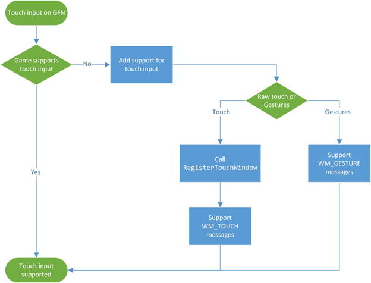

WM_TOUCH and WM_GESTURE are delivered to a game in the same way that other input messages are; they are passed through the window procedure (WindowProc). Therefore, these messages should be received by the game’s message loop and interpreted as applicable to the game’s needs.

The default window procedure (DefWindowProc) will clean up and invalidate the message’s data, so it must not be called before handling the message.  If the message is not handled, DefWindowProc **must** be called on the message.

For any messages that are handled, clean up must occur by calling either CloseTouchInputHandle() for WM_TOUCH, and CloseGestureInfoHandle() for WM_GESTURE. The following diagram shows the message processing flow and what APIs need to be called.

To allow for older applications to work on touch-enabled Windows devices, Windows automatically synthesizes mouse messages when touch input occurs. This means each touch action will also generate a WM_MOUSE message. This can cause your game to double-respond to each touch input, as it will receive both message types.

The canonical way to fix this issue is to check in the mouse handling code whether the message has come from a touch input or not.  For full details, see [https://docs.microsoft.com/en-gb/windows/win32/tablet/system-events-and-mouse-messages](https://docs.microsoft.com/en-gb/windows/win32/tablet/system-events-and-mouse-messages)

The game must check the extra message information (from GetMessageExtraInfo()) to see if it matches the bitmask 0xFF515700:

```c
#define MOUSEEVENTF_FROMTOUCH 0xFF515700

if ((GetMessageExtraInfo() & MOUSEEVENTF_FROMTOUCH) \== MOUSEEVENTF_FROMTOUCH) {  
    // Message was generated by touch input; ignore  
}  
else   {  
    // Message was generated by the mouse; process  
}
```

Note that GetMessageExtraInfo() must be called while handling the message; the information is only valid for the current message and cannot be obtained after the message has been handled or passed to DefWindowProc.

## Modifying UE4/UE5 Games for Touch Input
Epic Games’ Unreal Engine 4 and 5 (UE4/UE5) provides support for touch input as well as on-screen control overlays. As of version 4.27.2 and 5.0 Preview, Mobile Touch support is enabled by several changes in a project:

* Setting up Mobile Platforms  
* Enabling and handling Touch Events  
* Setting up the Touch Control Overlay  
* Invoking the game in touch mode

Note that the steps below focus on UE4. The same exact steps apply in UE5 as well; the difference is slight differences in option access/placement in the new Editor UI.

**Setup Mobile Platforms**  
While GFN hosts user games in a Windows environment, GFN supports user playing games on multiple mobile platforms. For the best experience on these platforms, the game should enable the platform support at a minimum and preferably have the user interface optimized for these platforms. Support for these platforms should be enabled as follows:

* Open the Project settings, and navigate to the “Platforms” section.  
* Under “iOS”, configure project settings and make sure “Supports IPad” and “Supports IPhone” are checked:  
  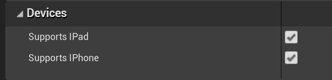
* Under “Android”, configure the package information. The rest of the settings can be left to their default values.

These options will enable touch overlay options for these platforms in the UE4 Editor.

**Enable Touch Events**

* Open the Player Controller Class and expand the “Mouse Interface” group.  
* Check “Enable Touch Events” to receive Touch Events of   
  * [On Input Touch Begin](https://docs.unrealengine.com/4.27/en-US/BlueprintAPI/Input/TouchInput/OnInputTouchBegin/index.html)  
  * [On Input Touch](https://docs.unrealengine.com/4.27/en-US/BlueprintAPI/Input/TouchInput/OnInputTouchBegin/index.html) End  
* Check “Enable Touch Over Events” to receive the Touch Over Events of  
  * [On Input Touch Enter](https://docs.unrealengine.com/4.27/en-US/BlueprintAPI/Input/TouchInput/OnInputTouchEnter/index.html)  
  * [On Input Touch](https://docs.unrealengine.com/4.27/en-US/BlueprintAPI/Input/TouchInput/OnInputTouchEnter/index.html) Leave

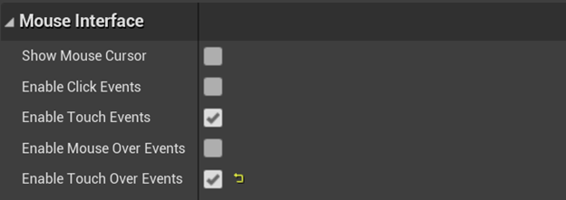

For more information about the events and how to connect them to specific actions, refer to the UE4 documentation found at [https://docs.unrealengine.com/4.27/en-US/BlueprintAPI/Input/TouchInput/](https://docs.unrealengine.com/4.27/en-US/BlueprintAPI/Input/TouchInput/), or whichever version of UE4 is used by the game.

**Setup Touch Overlay**  
Now that the game supports touch events, the next step is to inform the user where to touch on screen for game actions. UE4 provides default settings of two virtual joysticks to designate screen areas for touch input, and the sample projects provide a few customizations of this overlay:

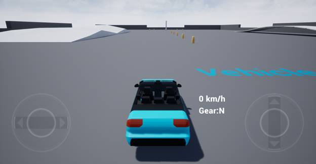

This overlay is enabled and customized via Project Settings under “Input”-\>”Mobile”:

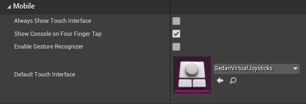

It is recommended to customize this overlay to provide users a great experience when playing on a touch device, making sure that the controls do not clutter the UI or block game viewing as well as adhere to other user experience recommendations found in this document. For more information on how to customize the overlay, please refer to the UE4 documentation.

It is not recommended to enable “Always Show Touch Interface” as this would show the touch control overlay in scenarios where touch is not enabled on the user’s client device, for example, the user is playing the game with a gamepad.

**Virtual Keyboard Support**  
UE4 provides support for an on-screen virtual keyboard when run on mobile devices and is enabled in the same “Input” section of the Project Settings:

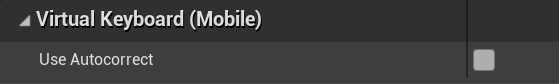

This keyboard can be used if the game requires text input by the user. However, as mentioned in the previous section of this document, GFN provides support for displaying the user’s preferred keyboard on their mobile device and sending the game input from that keyboard. Using this approach is preferred over the UE4 virtual keyboard.

**When to Enable Touch Input**  
UE4 will detect the system hardware and determine if touch should be enabled. However, since GFN utilizes Windows-based systems to host games, UE4 will not consider these systems as touch-enabled. While GFN will send touch events  for user input and UE4 will process them, the touch overlay will not be enabled by default and can confuse a user expecting to provide touch input. Therefore, there is additional work necessary to invoke the game with overlay support, which is accomplished by integrating the GFN SDK.

On game startup, the game should:

1. Initialize the SDK via *gfnInitializeRuntimeSdk.*  
2. Call *gfnCloudCheck* to determine if the game is running in GFN.  
3. If *gfnCloudCheck* returns true, call *gfnGetClientInfo* to get information about the client Operating System.  
4. If the API returns one of the mobile OS types, then it can be considered to support touch, and the game *may* manually enable the on-screen overlay.  
   1. A future SDK release will expand *gfnGetClientInfo* with direct knowledge of input type.

Note that there is a measurable number of GFN users on touch-enabled devices that do not use touch input, opting for controllers or other connected devices instead. For this set of users, displaying a touch-oriented interface can lead to a poor experience. To prevent this, a game must provide a way for a user to set a persisted game option that defaults input to their preferred type. This option should be used on all GFN launches going forward when *gfnGetClientInfo* returns the touch-oriented client device type.

Alternatively, it is possible to pass a startup command line option to the game to denote when the client device is touch-enabled. As this method requires custom configuration with GFN, please contact your NVIDIA Representative or NVIDIA Developer Relations for more information on this method.

**Manually Enabling Touch Control Overlay**  
Enabling the overlay when either the API checks return touch enabled or by existence of a touch command line can be accomplished by setting the “Is Mobile” option in the PlayerController Blueprint as well as defining the Platform Name that coincides with the OS type returned from *gfnGetClientInfo* API.

To set the Is Mobile option, set the “Is Mobile” option to true or create a Mobile Override that is set to true. 

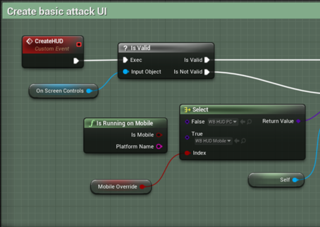

## Modifying Unity Games for Touch Input
Unity 2018 and later versions support touch input, allowing Unity-based games to natively support touch-enabled devices alongside other input types. Enabling a game to support touch input requires a handful of steps. These steps include:

* Installing and enabling the new Input System (if not already installed)  
* Configuring Touch Input Actions  
* Configuring Input Overlay  
* Invoking the game in touch mode

The steps defined below are specific to Unity 2018, and subject to change in newer versions.

## Using the New Input System

The first step is to make sure the new Input System that supports touch is available to the game. This is accomplished by opening the Package Manager under the “Window” menu item, and then setting the package source to “Unity Registry”. From there, scroll down to “Input System” and select “Install”.

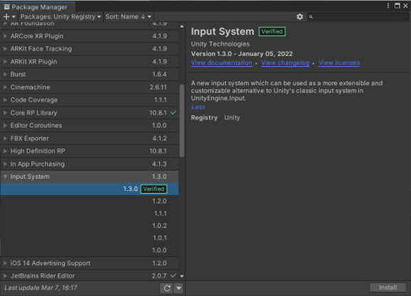

Once installed, Unity will ask if the input backends should be enabled:  
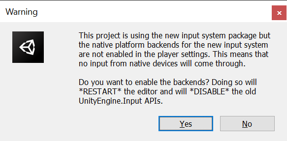

A selection can be made in this dialog, or it is possible to make changes in the Project Settings under the “Player” section, and then adjusting the value for “Active Input Handling”. For touch input, select either “New” or “Both” if legacy input options wish to be preserved.

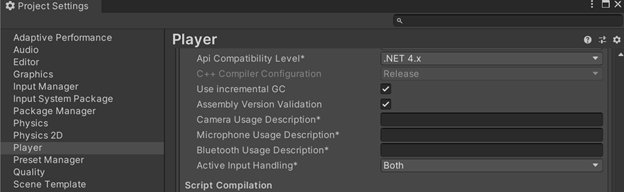

Any change to the Active Input Handling requires a Unity restart for the change to take effect. 

## Configuring Touch Events 
User-based touch events are enabled similar to keyboard, mouse or joystick input. This is done by creating new player-based Action Maps under the “Touch” Control Scheme. For example, under “Assets” a new Input Action can be created under the Input System.

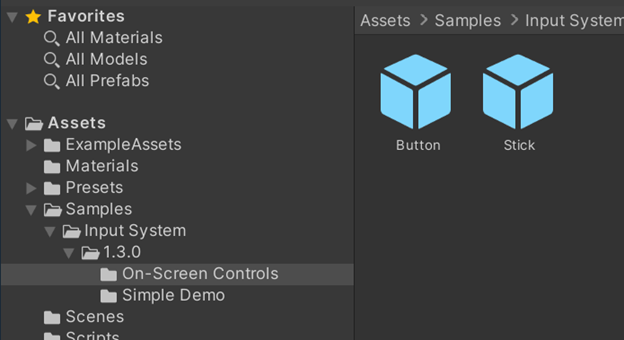

 From there, a new “Touch” control scheme can be created, with various actions defined to to either default input paths, or custom ones:

## Configuring Touch Overlay
Once touch support is enabled and various inputs are defined to actions, it is necessary to create an overlay of controls to educate the user where to touch on the screen for various input types. There are several ways to create an overlay, however, the easiest method is via the On-Screen Controls sample that comes with the Input System package. This includes a basic stock and button assets, which allow customization on placement on screen, or to be used as templates for various other actions. 


For details on how to configure the various settings, please refer to the Unity editor documentation.

As stated earlier in this document, it is important that the overlay be configured to be intuitive to the user, but not block the user’s view of the gameplay itself.

## Manually Enabling Touch Control Overlay  
As covered under the Unreal Engine section above, when a Unity-based game is run on GFN, it will receive Touch input, but it will not detect touch capabilities. As such, in order to know if the overlay should be enabled on game launch, at startup, the game should:

1. Initialize the SDK via *gfnInitializeRuntimeSdk.*  
2. Call *gfnCloudCheck* to determine if the game is running in GFN.  
3. If *gfnCloudCheck* returns true, call *gfnGetClientInfo* to get information about the client Operating System.  
4. If the API returns one of the mobile OS types, then it can be considered to support touch, and the game should manually enable the on-screen overlay.  
   1. A future SDK release will expand *gfnGetClientInfo* with direct knowledge of input type.

In addition, the same user input preference handling applies when the client device is reported as touch-enabled but the user prefers a different input type.

## Handling Basic Touch Input via Input Conversion

In the event that a game cannot immediately support touch input as described above, GFN can convert touch input on a client device into XInput gamepad messages on the GFN server. This allows a game to process the input just as if a physical gamepad was connected to the device.

To aid the user on touch input in this case, the GFN clients provide a standard gamepad-like overlay in-game with each touch area named for the standard XInput gamepad button the touch area corresponds to.

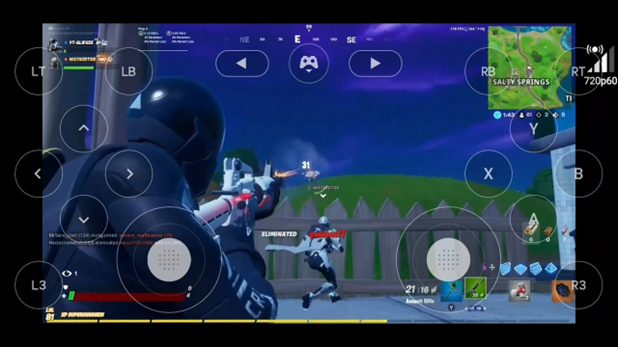

GFN clients will also support mouse through touch gestures such as one-tap click, two-tap right click and so on. The GFN client also supports input through on-screen keyboard, although the keyboard does have to be brought up manually using the chevron in the overlay located on top left of the screen.

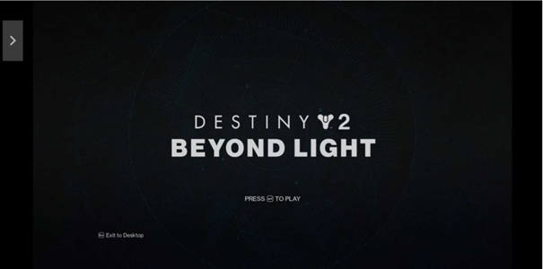


In this case, auto-centering the text edit box above the virtual keyboard is not supported, and thus the keyboard may overlap the edit box, making it difficult for the user to see their input.

Note that this input method is a less optimal solution than the implementation methods described earlier in this document, as it has several drawbacks:

* The overlay’s UI elements are static and cannot be moved to accommodate the user’s input preferences.  
* The overlay’s UI elements can interfere with game UI elements, requiring the game to rework the UI for a better experience.  
* Depending on the relative position between the edit box and the keyboard, the keyboard may obscure the visual input.

As such, this method of input can be considered a first step to have a game support GFN mobile devices in parallel to full development of mobile touch, but is not desirable to be the final integration with GFN.

## Handling Text Input from Touch Devices

There are instances during game play where the user must provide keyboard-based input, for example, entering their username or password, or typing the name of a friend to message via an in-game friends list. Traditionally this would mean the game would need to implement some keyboard interface, along with support for the major keyboard layouts and locales. 

GFN provides a way for that input to be obtained by the game via the native on-screen keyboard of touch-based devices, thus removing the need for the game to implement methods to obtain text input directly. 

Since only the game knows when keyed input is necessary, control over the on-screen keyboard is managed by the game via APIs provided by the GFN Software Development Kit (GFN SDK). 

The *gfnSetActionZone* API provides a way for a game to define areas of the screen that should trigger keyboard-based input. The API’s definition is:

```c
GfnError gfnSetActionZone(GfnActionType type, unsigned int id, GfnRect\* zone);
```

A correct call to this API includes:

* type as gfnEditBox  
* id as a caller-defined unique identifier  
* zone as the bounds of the on-screen region. See SDK documentation on GfnRect for more information on how to define this region.

An example code snippet for registering an edit box that is 20 pixels high and 100 pixels wide, with top-left XY coordinates of 5,10:

```c
GfnRect editboxRect = {5, 10, 100, 20, false, gfnRectXYWH};  
GfnError result = gfnSetActionZone(gfnEditBox, 1, \&editboxRect};
```

When called, the API signals the GFN client running on the user’s host device to monitor the defined screen area for touch input. This API is designed to be safe to call for all client types; the game does not need to know the client is a mobile device before calling the API. In cases where the client is not touch-enabled, the API call is a no-op.

If the edit box position changes on screen, for example, the user scrolls the menu that contains the edit box, the game should call the gfnSetActionZone API again with the same ID and the new coordinates so that the GFN client can monitor the correct regions of the device screen.

When the GFN client receives a tap in the monitored area, the GFN client will first bring up the device’s virtual keyboard and shift up the video view to place the edit box above the keyboard so there is not an overlap of the keyboard onto the text edit box.

As the user enters text via the keyboard, the text is sent to the game server and into the game. Once the keyboard is dismissed, the viewport is panned back to allow the full game screen to be displayed. GFN also allows users to use native international language keyboards to input text.

When a display region should no longer be monitored for such input, for example, the user leaves the game menu that hosts the edit box, the gfnSetActionZone API is called with the same id value, and with the zone parameter set to null pointer. This will delete the rectangular screen region associated with the id from being monitored. For example:

```c
GfnError result = gfnSetActionZone(gfnEditBox, 1, nullptr};
```

Failure to call the API to remove the region will result in erroneous cases where the keyboard “randomly” comes up on screen for the user if they happen to tap in the registered revision.

For more detailed information on the API as well as different ways a GfnRect can be defined, refer to the GFN SDK API documentation.

## Working with Device Resolutions

All games on GFN are played in a fullscreen mode, taking up most or all of the device’s screen area.  When playing on mobile devices, this can have some special implications that need to be considered and handled to achieve the best gaming experience.

Touch devices often come in wider screen resolutions and aspect ratios than standard PCs, and games must support these mobile screen aspect ratios. Typical aspect ratios used in mobile screens are 16:9, 18:9, 18.5:9, 19:9, 19.5:9, 20:9. GFN clients will auto detect the mobile screen aspect ratio and request the game to render at a resolution corresponding to the detected aspect ratio as in the table below.

When a gaming session is launched on a touch device, the device’s resolution drives the resolution that GFN will set the streaming server to render at. Therefore, it is important for a game to support at least the various resolutions of the most popular touch devices, preferably for best experience on all devices, the game supports rendering at “any” resolution.The following table provides examples of the most common resolutions for the most popular devices used with GFN:

| Aspect ratio | Resolutions | Example Devices |
| :---: | ----- | ----- |
| 4:3 | 1024x768, 1080x810, 1194x834, 1366x1024 | iPad |
| 3:2 | 1133x744 | iPad Mini 6 (2021) |
| 10:7 | 1194x834 | iPad Pro 11” (2018-2020) |
| 16:9 | 1920x1080, 1280x720 | Samsung S6/S7 and iPhone 8/9 |
| 18.5:9 | 2046x990, 1364x660 | Samsung S8/S9 |
| 19:9 | 2052x972, 1368x648 | Samsung S10 |
| 19.5:9 | 2106X972, 1404X648 | iPhone 11/12 |
| 20:9 | 2120x954, 1400x630 | Samsung S20 |
| 19.5:9 | 2340x1080, 3088x1440 | Samsung S22 & Ultra |
| 19.5:9 | 2556x1179, 2796x1290 | iPhone 14 Pro/Plus |

Detection of which resolution to render at can be accomplished by handing the modeset issued by Windows when GFN sets the system resolution to match the touch client device, or calling Win32 APIs to obtain the GFN system resolution under which the game is current running, as the GFN system will be running at the resolution of the client touch device for best streaming experience..

## Handling Special Device Screen Features

Most mobile touch devices have areas of the screen that do not respond if touched, or that should not be used for displaying important information.  Touch warping and Safe areas are techniques to mitigate this.

Some devices have screens that are not entirely rectangular.  For example, a number of phones have notches or cutouts for buttons or user-facing cameras. Regions close to the edges may also be used by operating system-level UI elements. Display elements in such regions may also be cropped unpleasantly.

To avoid such areas, it is recommended that games provide a “safe area”, or an area around the edges of the device screen where important game and UI elements are not placed.

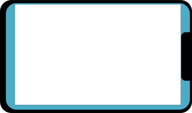

In the screen diagram above, the white area is suitable for displaying game content. The blue area should be avoided due to the camera notch on the right, OS button area on the left, and the screen curved area at the top and bottom.  
   
To aid in a positive experience for the user, the GFN client will automatically ‘warp’ touches that are at or near the edges of the touchable area to be closer to the edge, to allow for touching of on-screen elements or controls that are near the edges of the screen.  However, this is only intended for the non-touchable areas at the very edges of the screen, and does not accommodate safe areas in their entirety. Further, touch warping does not prevent your game elements from being shown on a part of the screen that is unavailable for context.

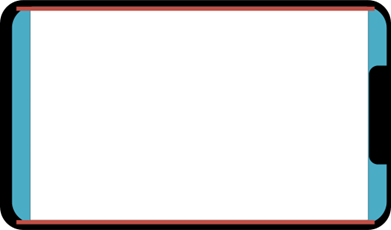

In the diagram above, touches in the red area would not be detected, and so touches near to the red area in the white area adjacent are warped to appear to be within the red area.

To help the game running in GFN in handling these areas on the client device, GFN has infrastructure for the game to know how far to offset UI and other elements from the edges of its rendering window. This is to make sure the user’s gaming experience is not interrupted by these areas on the client device without the game itself having to know the specifics of the client device and having to maintain a list of these areas for each device. 

To accomplish this, the GFN client running on the device will detect the device type and its current rotation (landscape or portrait), as well as other specifics to generate offsets known as Dynamic Safezones.

The GFN SDK then provides the ability to retrieve these Dynamic Safezone areas for the client device. To obtain this information, the game must register for the ClientInfoCallback callback via the gfnRegisterClientInfoCallback function. Once registered, the GFN SDK will trigger the callback with the gfnSafeZone updateType, and will continue to trigger the callback any time the safezone data changes, for example, when the user rotates the device.

The safezone data received from the callback will be in a GfnRect with GfnRectFormat of gfnRectLTRB, and the data itself will be *normalized* of a value between 0 and 1\. For example, using a Galaxy S22 in landscape mode as the client device, the ClientInfoCallback will provide the following safezone data:

```c
GfnRect.value1 = 0.031006;  
GfnRect.value2 = 0.0;  
GfnRect.value3 = 0.031006;  
GfnRect.value4 = 0.012;  
GfnRect.normalized = true;  
GfnRect.format = gfnRectLTRB;
```

This translates to:

* Left-side value of 0.031006.  
* Top value of 0.0.  
* Right-side value of 0.031006.  
* Bottom value of 0.012.

Once the safezone data is obtained, the normalized values can be calculated against the game’s resolution:

* Left-side offset amount \= GfnRect.value1  \* GameResolutionWidth  
* Top offset amount \= GfnRect.value2 \* GameResolutionHeight  
* Right-side offset amount \= GfnRect.value3  \* GameResolutionWidth  
* Bottom offset amount \= GfnRect.value4 \* GameResolutionHeight

Reusing the S22 example values, and using a game window resolution of 1920 pixels wide and 1080 pixels high, UI elements should be at least:

* 59.531 pixels from the left edge of the game window (1920 x 0.031006)  
* 0 pixels from the top edge of the game window (1080 x 0.0)  
* 59.531 pixels from the right edge of the game window (1920 x 0.031006)  
* 12.96 pixels from the bottom edge of the game window (1080 x 0.12)

Moving UI elements away from the edges by at least these values will guarantee that UI elements will not interfere with screen features when rendered on the client device by the GFN client application.

If the user rotates their device, then new values will be sent, and the calculation can be performed again to adjust the UI elements. The game does not need to know which way the device rotated, as the GFN client will maintain the proper aspect ratio to the game resolution, applying black bars to areas of the client device screen as necessary.

## Best Practices for Touch Devices

For the best experience for players, the following items should be considered while reworking a game to support touch input while running in GFN:

**Make sure the UI is touch friendly and intuitive**  
It is important to define a UI that clearly informs the user of what the touch inputs do while not getting in the way of the game’s action. Equally important is that the touch input layout feels “natural” to the user, preferably customizable by the user. The input should not require the user to move their hands around, possibly losing grip on their device, nor should it require extremely precise pixel hits to trigger an action.

As such, a game designed for touch input will often have a different user interface from one designed solely for gamepad or keyboard and mouse input.

There are many options for such a game.  However in general when touch input is used:

* Mouse-style movement is better replaced by an alternative:  
  * For example, if a game uses mouse movement to move a virtual-world camera, then that needs to be replaced by a different input mechanism \- commonly, dragging a finger around on-screen \- to provide that same functionality.  
* Scroll-wheel gestures are no longer easy  
  * Instead of having a scroll-wheel style selection of items, a replacement would be to have an explicit inventory mechanism that allows selection via touching the inventory item.  
  * If your game provides its own zooming, you must all respect and support the  pinch-to-zoom gesture that is now the common way of zooming on touch devices.  
* Gamepad controls are not present  
  * Use on-screen tappable areas, or provide an alternative input system, rather than relying on “always available” gamepad controls.  
* Keyboard input isn’t viable  
  * Whilst text entry might be possible, for gameplay the keyboard isn’t available.  Try to provide different user interface elements to access any game functions that the keyboard would be used for.  For example, a touchable fire button or an automatic firing system could be an option.  
* Physical screen size is smaller  
  * Mobile touch devices tend to have physically small screens, even if their screen resolutions are large.  Ensure that your game interface works when the elements are physically small; make them large enough to see and touch cleanly.

**Handle when the user has multiple input types**  
Some touch-based devices will have physical controllers connected, and for some devices and OSes, they will not be detectable until the user physically pressed a button. If a device registers controller input, and the touch overlay is visible to the user, best practice is to face that overlay out of the way of the user’s gameplay.

**Handle when the user switches to/from from touch input**  
There are cases where a game can receive controller input and then touch input, or vice versa. For example, the user is streaming the GFN session on their PC and resumes on their tablet. In those cases, the game will first receive traditional keyboard and/or mouse input, then suddenly receive touch events. In those cases, best practice is to allow the user an easy way to switch their default input type. Additionally, the touch overlay can be rendered and removed as the input type dictates. For example, if a touch event is registered, and the overlay is not presently rendered, then the overlay can be rendered. If the overlay is rendered, and gamepad input is consistently received, then the overlay can be hidden.

**Be cognisant of screen limitations**  
As stated in the section on “Handling Device Screen Features”, many devices have screens that contain features that inhibit game play. It is useful to sample popular devices before and after game release to make sure UI elements and other game-related objects are not blocked by camera pinholes or curved screens, and rely on safezone data provided by the GFN SDK APIs to calculate these areas.

**Be cognisant of black borders**  
Related to the point above, it is important to define safe areas to prevent game elements from filling unusable areas of the screen. However, it is best not to take a common-denominator approach to defining the usable screen area. This can lead to unnecessary or oversized black bars on some user devices, making the game less immersive. Try to define areas that make it feel like the game was built for that very device.

**Limit typing by the user**  
While GFN provides a native interface to obtain text input from the user, typing on a virtual keyboard is a bad experience for most users. Find ways to make touch lists for things a user would type if using a traditional PC. For example, if a multiplayer game leverages chat boxes to talk to other players, look to categorized touch-based lists for common phrases typed in. Instead of users typing in a price or time for something, use a scrolling list of values. If users are required to enter username and password information on startup of the game, consider integrating Account Linking and Single Sign-On with GFN. See the Account Linking integration guide provided as part of the GFN SDK’s documentation.

## Conclusion and Next Steps

GeForce NOW provides a way for gamers to enjoy their PC games almost anywhere, and publishers to reach more gamers. With the ability of PC games to be played on mobile devices, the gamer audience is even more expansive and diverse. 

Along with integrating other GFN-enabled features such as account linking with your user accounting system and enabling single sign-on to bypass the need for users to log into your game during the stream, enabling mobile touch in your game creates an efficient and seamless experience for your users to enjoy your games on GFN. 

To have your games take advantage of the Mobile Touch feature, or any other feature GFN provides, please contact your NVIDIA Developer Relations representative for more information on onboarding and testing your game on GFN.
